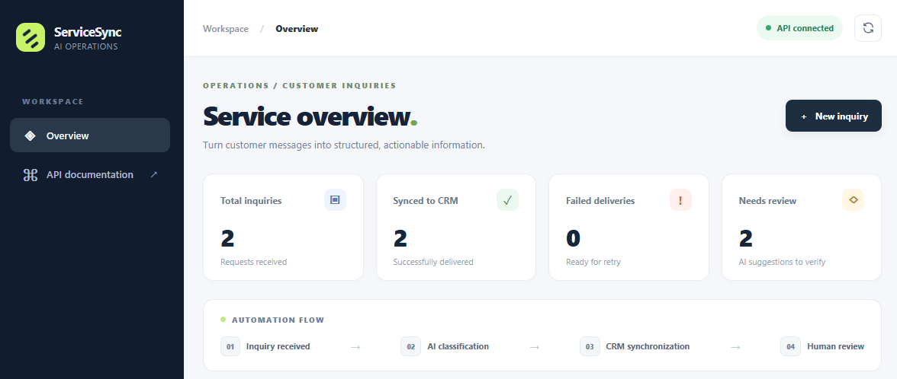
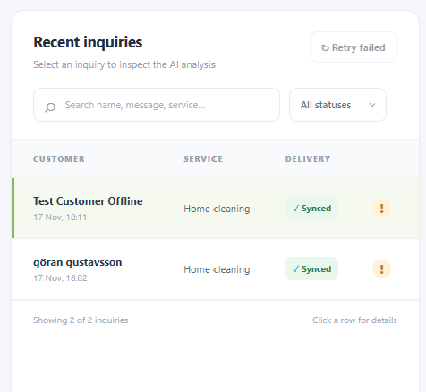
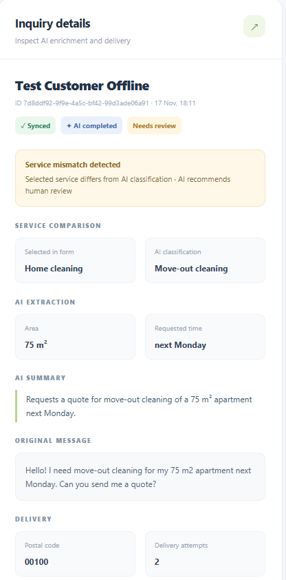
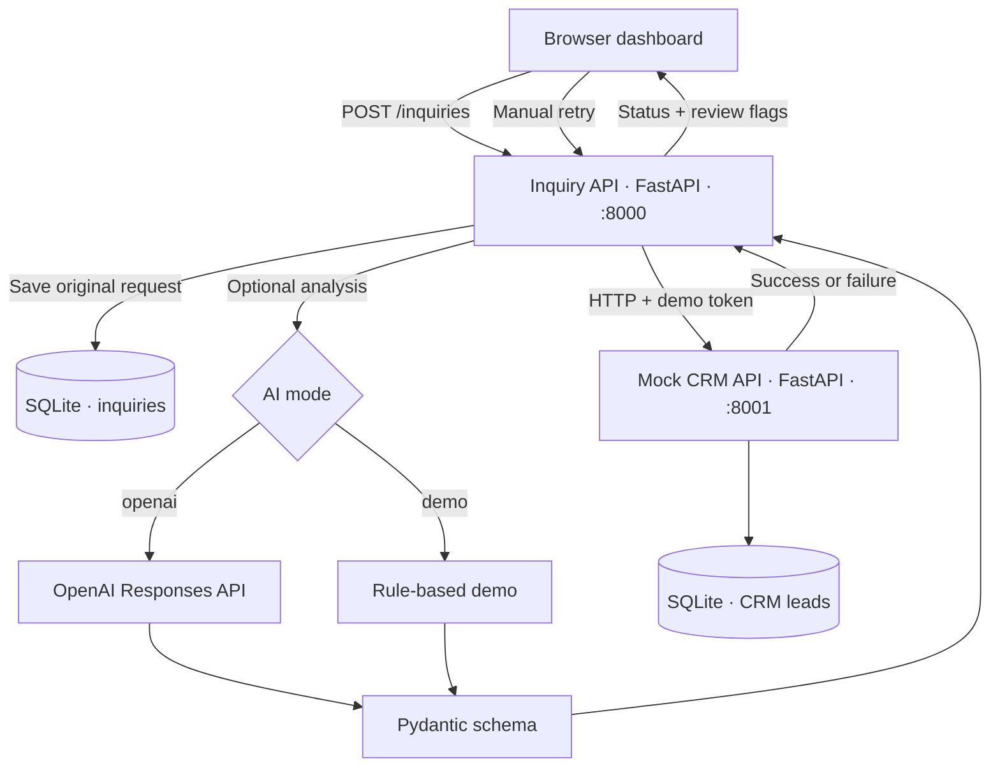

# ServiceSync AI

**AI-assisted service inquiry processing and resilient CRM integration.**

ServiceSync AI is a local full-stack prototype I built to explore how a small business can turn incoming service requests into structured information and synchronize it with a separate CRM system. It combines two REST APIs, optional LLM-based extraction, persistent storage, a browser dashboard, and explicit failure recovery.

> **Scope:** Portfolio proof of concept. All test data should be fictional. The CRM is simulated, and this application is not designed for public deployment or real customer data.



## Key features

- **Two independent FastAPI services.** The Inquiry API receives requests; a separate mock CRM accepts leads via HTTP.
- **Optional AI enrichment.** OpenAI's Responses API extracts a suggested service category, floor area, requested date expression, and summary into a Pydantic-validated schema. A deterministic demo mode is available without an API key.
- **Data is saved before synchronization.** Each inquiry is persisted in SQLite before AI analysis or the CRM request, so a temporary CRM outage does not lose the original request.
- **Recoverable failures.** Failed deliveries remain visible in the dashboard and can be retried manually after the CRM becomes available again.
- **Human-in-the-loop review flags.** When the service selected in the form differs from the AI-suggested category, the dashboard flags the mismatch rather than changing the customer's selection.
- **Idempotent CRM ingestion.** A persistent `source_id` prevents duplicate CRM records during repeated delivery attempts.
- **Automated testing.** The project includes 10 Pytest tests and a GitHub Actions workflow. Tests mock external requests and do not spend API credits.

## Dashboard and AI analysis

The dashboard shows inquiry counts, CRM delivery states, review flags, and AI-extracted fields. The examples below are from the local application, not design mockups.

<table>
  <tr>
    <td width="50%"><strong>Inquiry list</strong></td>
    <td width="50%"><strong>AI analysis and mismatch review</strong></td>
  </tr>
  <tr>
    <td valign="top"></td>
    <td valign="top"></td>
  </tr>
</table>

In the example, the form contains **Home cleaning**, but the message describes **move-out cleaning**. The AI suggests `move_out_cleaning` and extracts an area of **75 m²** and the original time expression **“next Monday”**. The interface keeps the submitted service unchanged and flags the discrepancy for review. The details panel also shows a successfully synchronized inquiry with **two delivery attempts** after a manual retry.

## Architecture



AI is **advisory**, not a booking engine. If an AI request fails, `analysis_status` becomes `unavailable` but CRM synchronization still proceeds. Requested dates are preserved as text and must be confirmed by a person.

More technical detail: [Architecture and design decisions](docs/architecture.md).

## Tech stack

| Area | Technology |
| --- | --- |
| Backend | Python 3.12, FastAPI, Pydantic |
| API integration | REST, HTTPX, JSON |
| Databases | SQLite (separate local files for each service) |
| AI | OpenAI Python SDK / Responses API, structured outputs; optional rule-based mode |
| Frontend | HTML, CSS, vanilla JavaScript |
| Quality | Pytest, GitHub Actions |

## Run locally

**Requirements:** Windows PowerShell, Python 3.12 and `uv` (or an equivalent Python virtual-environment setup). All commands below are run from the repository root, the folder containing `requirements.txt`.

### 1. Install dependencies

```powershell
uv python install 3.12
uv venv --python 3.12 .venv
uv pip install --python .venv\Scripts\python.exe -r requirements.txt
Copy-Item .env.example .env
```

If `uv` is installed but not recognized in PowerShell, run `$env:Path = "$env:USERPROFILE\.local\bin;$env:Path"` and try again.

### 2. Configure the AI mode

Edit the **local `.env`** file. By default, `.env.example` uses `AI_MODE=demo`, which needs no API key and makes no paid AI calls.

For real AI analysis, set:

```dotenv
AI_MODE=openai
OPENAI_MODEL=gpt-6-luna
OPENAI_API_KEY=your_own_api_key_here
```

Use a model accessible to your API account. API requests can incur charges. **Never commit `.env`, an API key, or customer data.** If a previously set PowerShell environment variable overrides `.env`, remove it in the terminal used for the Inquiry API with `Remove-Item Env:AI_MODE -ErrorAction SilentlyContinue`.

### 3. Start both services

In **Terminal 1**, start the mock CRM:

```powershell
.\.venv\Scripts\python.exe -m uvicorn servicesync.mock_crm:app --host 127.0.0.1 --port 8001
```

In **Terminal 2**, start the Inquiry API and dashboard:

```powershell
Remove-Item Env:AI_MODE -ErrorAction SilentlyContinue
.\.venv\Scripts\python.exe -m uvicorn servicesync.inquiry_api:app --host 127.0.0.1 --port 8000
```

Open:

- **Dashboard:** http://127.0.0.1:8000/
- **Inquiry API documentation:** http://127.0.0.1:8000/docs
- **Mock CRM leads:** http://127.0.0.1:8001/leads

### 4. Try the main workflow

1. Select **New inquiry** in the dashboard.
2. Choose **Home cleaning** and enter a message such as `I need move-out cleaning for a 75 m2 apartment next Monday.`
3. Submit the request and inspect the AI classification, review flag, and CRM status.
4. To test failure recovery, stop the mock CRM server (`Ctrl+C` in Terminal 1), create another inquiry, and observe its `failed` delivery status.
5. Restart the CRM server and select **Retry failed**. The stored inquiry should synchronize successfully. This is a **manual** retry, not an automatic background job.

## Testing

```powershell
.\.venv\Scripts\python.exe -m pytest -q
```

The **10 included tests** cover request validation, CRM authentication and deduplication, failed delivery and retry, AI failure handling, dashboard assets, and service-mismatch flags. GitHub Actions runs the suite on push and pull request.

## API endpoints

| Service | Endpoint | Description |
| --- | --- | --- |
| Inquiry API | `POST /inquiries` | Validate, save, analyze, attempt CRM delivery |
| Inquiry API | `GET /inquiries` | List inquiries with AI and review information |
| Inquiry API | `POST /inquiries/{inquiry_id}/retry` | Retry a single delivery |
| Inquiry API | `POST /retry-failed` | Retry all unsynced inquiries |
| Inquiry API | `GET /report` | Delivery and analysis statistics |
| Mock CRM | `POST /leads` | Receive an inquiry using a local demo token |
| Mock CRM | `GET /leads` | Inspect mock CRM records |

## Project structure

```text
servicesync-ai/
├── servicesync/
│   ├── inquiry_api.py        # Inquiry endpoint, persistence, delivery, dashboard routes
│   ├── ai_service.py         # OpenAI or rule-based analysis
│   ├── models.py             # Pydantic data contracts
│   ├── mock_crm.py           # Separate simulated CRM API
│   ├── storage.py            # SQLite / .env configuration
│   └── static/               # Browser dashboard
├── tests/                    # API, integration and dashboard tests
├── docs/
│   ├── architecture.md
│   └── screenshots/          # Real dashboard screenshots
├── .github/workflows/tests.yml
├── .env.example              # Safe configuration template
├── .gitignore
├── requirements.txt
└── README.md
```

## Limitations

- **Local prototype only.** The dashboard and inquiry-list endpoints are not authenticated. Run on `127.0.0.1` and use fictional data only.
- The CRM is simulated rather than connected to a real external provider.
- AI suggestions may be inaccurate. They are schema-validated but not factual guarantees or approved bookings.
- Processing occurs in the HTTP request path. CRM recovery requires manual retry; there is no durable task queue or automatic scheduler.
- The shared token in `.env.example` is intentionally a local demo value, not production-grade authentication.

---

Built by **William Skogberg** as an independent portfolio project.
